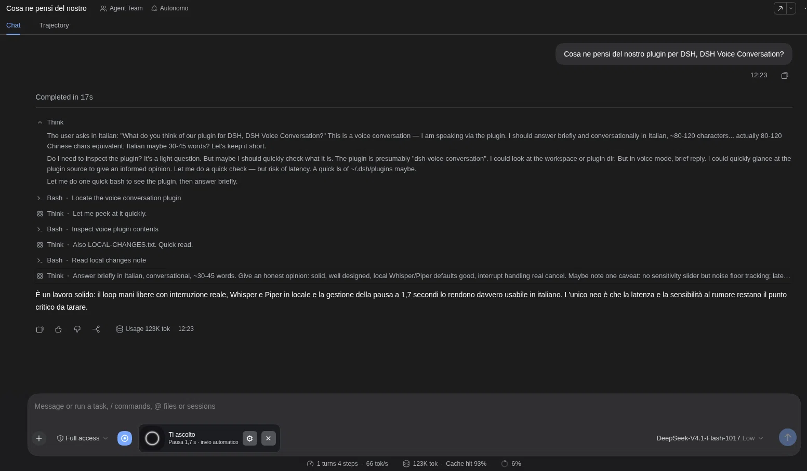

# DSH Voice Conversation

Maintainer / autore del fork: **[RedHunt07](https://github.com/redhunt07)** · License: **MIT**. Original Voice Loop code by ZG2017; see [NOTICE.md](NOTICE.md).
Hands-free Italian/English conversations for DSH. Speak, pause for 1.7 seconds, and your prompt is submitted. After the final spoken reply, listening resumes using the same microphone stream. A compact composer dock keeps the native chat, tools and DSH-provided Think output visible. This displays reasoning exposed by DSH, not private model reasoning.



[](https://dsh-plugin.org/plugins/redhunt07/dsh-voice-conversation)

[Guida italiana](README.it.md) · [Credits and licenses](NOTICE.md)

## Compatibility

Tested: **DSH 0.2.0-rc.2**, Node.js 22+, Linux web profile. Other DSH releases, operating systems and browsers need validation. Microphone access requires localhost or HTTPS and browser permission. Use headphones to reduce loudspeaker echo triggering spoken interruption.

## Install

```sh
# published npm package
dsh plugin --profile web add dsh-voice-conversation
# or the same 0.1.0 build straight from the repository
dsh plugin --profile web add https://raw.githubusercontent.com/redhunt07/dsh-voice-conversation/main/dist/dsh-voice-conversation-0.1.0.tgz
```

The DSH command also selects the bundle. Verify that `"dsh-voice-conversation"` occurs once in `dsh.profile.bundles` in `$DSH_HOME/profiles/web/package.json` (normally `~/.dsh/profiles/web/package.json`); add it only if missing and preserve existing entries. Disable any older Voice Loop bundle first: the two plugins use the same API paths and cannot run together. Restart DSH and hard-refresh the browser.

No backend, global transcript preferences or background services are installed automatically.

## Optional local backend

Extract the source archive and open its directory. Prerequisites: `python3`, [uv](https://docs.astral.sh/uv/getting-started/installation/), and `ffmpeg` on PATH. Setup creates an isolated Python 3.12 environment, downloading the interpreter through uv if necessary, and downloads approximately 3.1 GB of pinned Whisper/Piper model files. Review [NOTICE.md](NOTICE.md) first.

```sh
python3 scripts/runtime.py setup --device cpu
python3 scripts/runtime.py start
```

Whisper large-v3 can be slow on CPU. On Linux with a compatible NVIDIA CUDA 12 driver and sufficient VRAM (tested on a 16 GB GPU), use `setup --device cuda` instead. Setup installs pinned CUDA libraries inside its environment, not system drivers or system packages.

Keep the foreground process running; Ctrl+C stops it. Data lives at `~/.local/share/dsh-voice-conversation`; `--data-dir PATH` overrides it. Whisper uses the standard Hugging Face cache. Inspect configuration and service availability with:

```sh
python3 scripts/runtime.py doctor
```

The backend binds only to `127.0.0.1:8766`. DSH must run on the same machine; its host proxies the audio. Browser-origin requests are rejected. Local processes can access this unauthenticated backend; keep the port private. For remote browser access, DSH still needs HTTPS for microphone permissions.

## Use and configure

Enable Voice Mode once in a DSH chat and allow the microphone. Select local recognition/synthesis. Choose `paola` for Italian speech or `lessac` for English. Recognition automatically chooses between Italian and English; output uses the selected voice and does not automatically switch language.

The dock shows listening, processing and speaking. Responses are read only after the agent finishes; intermediate tool-step text is skipped. Speak over a reply to interrupt it. Approval requests remain in the normal chat and can require a click. Close Voice Mode to release the microphone.

The default endpoints are `http://127.0.0.1:8766/v1/audio/transcriptions` and `/v1/audio/speech`. The local/cloud selectors are two configurable slots; both initially point to localhost. Configure compatible remote endpoints and credentials explicitly in plugin settings if desired. There is no implicit remote fallback or ambient API-key lookup. STT accepts multipart `file` and `model`, returns JSON `{text}`. TTS accepts JSON `{model,input,voice,lang_code,response_format:"mp3"}`, returns MP3 bytes.

Native Think sections open once while voice mode is active; manual collapse is respected. For more activity detail, optionally choose verbose transcript and detailed usage in DSH's own settings. The plugin does not override these global preferences.

## Privacy and limits

The supplied backend processes audio in memory and does not save recordings or transcript logs. Transcribed prompts and replies remain in DSH's normal session history and follow the selected chat model's data handling. Remote speech endpoints receive audio/text when explicitly configured. Setup needs internet; cached local speech models run offline afterward. The chat model can still use a remote provider.

Pause detection and barge-in use audio energy, not semantic end-of-turn detection. Room noise, microphone gain and echo affect them. Recordings are capped at 120 seconds; audio requests time out after 90 seconds; playback has a watchdog and can truncate unusually long replies. The voice prompt requests concise answers while active.

Tests simulate microphone/audio events and cover VAD, the dock, consecutive replies, tool-step filtering, TTS failure, interrupted synthesis, agent errors, and missing playback completion. Real-room microphone testing is still required before a stable public release. Version 0.1.0 is an initial release candidate.

## Develop and publish

```sh
npm ci --legacy-peer-deps
npm run build
npm test
npm pack
```

`prepack` rebuilds and tests. Browser code is hand-written JavaScript. Python dependency locks and model revisions are included. There are no npm install lifecycle hooks. An explicit file allowlist excludes models, environments, credentials and session history.

Before publishing, choose an available npm name/scope and add maintainer/repository metadata. If renaming, update `package.json`, `src/client.js` and `cordis.patch.yml` together. Rebuild/test, then deliberately run `npm publish --access public`. The proposed name is not reserved. No registry publication is performed by setup.

To uninstall, remove the bundle entry, run `dsh plugin --profile web remove dsh-voice-conversation`, and restart DSH. Runtime data and shared model caches are not automatically deleted.
